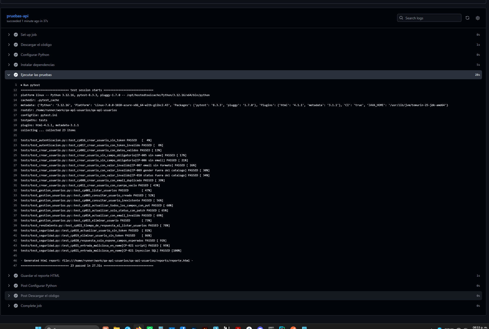
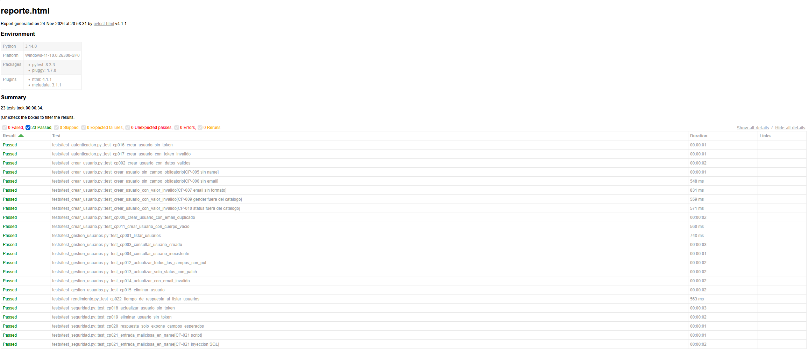
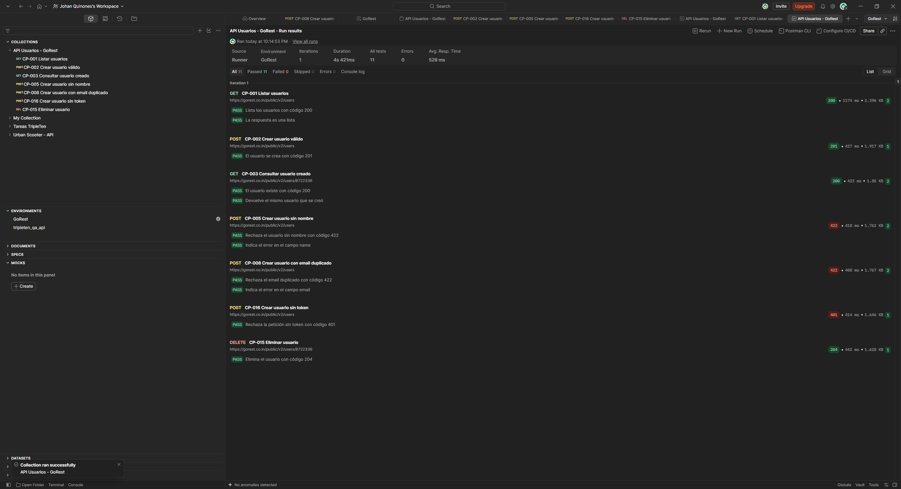
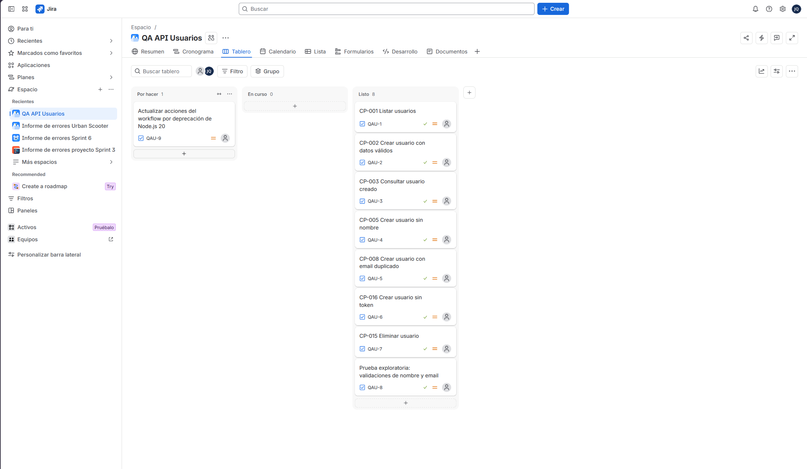

# Validación de la API de registro y gestión de usuarios

Proyecto de QA de extremo a extremo sobre una API REST de usuarios: plan de pruebas, diseño de casos, ejecución manual y prueba exploratoria en Postman, trazabilidad en Jira y una suite automatizada con Python y Pytest que se ejecuta sola en GitHub Actions.


> **Autor:** Johan Felipe Quiñones Díaz · QA Tester · Bogotá, Colombia
> [LinkedIn](https://www.linkedin.com/in/johanquinonesqa) · [GitHub](https://github.com/JohanQD)

---

## 1. Problema identificado

En una fintech, un e-commerce o cualquier plataforma digital, el registro y la gestión de usuarios es la puerta de entrada del cliente. Si la API que lo soporta falla, el impacto llega directo al negocio:

- **Datos inválidos o incompletos** que generan clientes mal registrados y reprocesos.
- **Usuarios duplicados** que afectan la trazabilidad y los reportes.
- **Accesos sin autenticación** que exponen o modifican información de terceros.
- **Errores no controlados** que se convierten en casos de soporte y en mala experiencia.

**Pregunta de negocio:** ¿la API registra, consulta, actualiza y elimina usuarios de forma correcta, segura y consistente, y rechaza con claridad los datos inválidos?

## 2. Solución desarrollada

Apliqué un ciclo completo de QA sobre la API pública [GoRest](https://gorest.co.in) (recurso `/public/v2/users`), que usa autenticación con token Bearer y responde con errores de validación por campo, igual que muchas APIs reales.

1. **Plan de pruebas:** alcance, riesgos, enfoque y criterios de aceptación. → [docs/plan-de-pruebas.md](docs/plan-de-pruebas.md)
2. **Diseño de casos de prueba** con partición de equivalencia y análisis de valores límite. → [docs/casos-de-prueba.md](docs/casos-de-prueba.md)
3. **Ejecución manual en Postman** de los 7 casos principales (crear, consultar, eliminar, datos inválidos, duplicados y acceso sin token), con verificaciones en scripts, peticiones encadenadas con variables y la colección exportada. → [postman/](postman/)
4. **Prueba exploratoria en Postman** de 5 casos fuera del plan inicial: nombres con solo espacios, emails con espacios y longitud del nombre con análisis de valores límite.
5. **Trazabilidad en Jira:** cada caso de prueba, la prueba exploratoria y una tarea técnica del pipeline quedaron registrados como tickets. La plantilla de reporte de defectos está en [docs/reportes-de-bugs/](docs/reportes-de-bugs/).
6. **Automatización con Pytest** de los casos de mayor riesgo, organizados por tipo (`smoke`, `regression`, `security`, `performance`). Cada prueba crea sus propios datos y los elimina al terminar. → [tests/](tests/)
7. **Integración continua con GitHub Actions:** la suite corre en cada cambio, con el token guardado como secreto del repositorio, y genera un reporte HTML descargable. → [.github/workflows/api-tests.yml](.github/workflows/api-tests.yml)

## 3. Herramientas utilizadas

| Área | Herramientas |
| --- | --- |
| Pruebas manuales y exploratorias de API | Postman (scripts de pruebas, variables, Collection Runner) |
| Gestión de casos y hallazgos | Jira (plan gratuito) |
| Automatización | Python, Pytest, requests |
| Reportes | pytest-html |
| Control de versiones e integración continua | Git, GitHub, GitHub Actions |
| Técnicas de diseño | Partición de equivalencia, valores límite, pruebas negativas, pruebas de seguridad básicas, prueba exploratoria |

## 4. Resultados

| Indicador | Resultado |
| --- | --- |
| Casos de prueba diseñados | 22 (CP-001 a CP-022) |
| Casos ejecutados en Postman | 7 casos principales y 5 exploratorios |
| Verificaciones en Postman (Collection Runner) | 11 de 11 aprobadas en 4,4 s |
| Pruebas automatizadas con Pytest | 23 de 23 aprobadas |
| Tiempo de ejecución de la suite automatizada | 27 s en GitHub Actions y 34 s en local |
| Tickets en Jira | 9 (7 casos de prueba, 1 prueba exploratoria y 1 tarea técnica) |
| Defectos encontrados en la API | 0 |
| Ejecución en CI | En cada push, con reporte HTML como artefacto |

**Hallazgos principales:**

- **Regla de negocio descubierta en la prueba exploratoria:** el nombre admite como máximo 200 caracteres. La confirmé con valores límite: 200 caracteres se aceptan (201 Created) y 201 se rechazan (422, "is too long (maximum is 200 characters)").
- **Validaciones correctas:** la API rechaza con 422 los nombres con solo espacios, los emails con espacios, los emails duplicados y los campos obligatorios vacíos, y con 401 las peticiones sin token. No se encontraron defectos en los casos probados.
- **Tarea técnica en el pipeline:** GitHub Actions advierte que Node.js 20 está en desuso para las acciones del workflow. Quedó registrada en Jira para actualizar las versiones antes de que se desactive el soporte.

**Valor para una empresa:**

- Una regresión automática que se ejecuta en cada cambio y detecta fallos antes de que lleguen al cliente.
- Casos de prueba trazables a los riesgos del negocio (datos inválidos, duplicados, accesos no autorizados).
- Pruebas independientes y repetibles: cada una crea sus datos y los limpia, sin depender de información existente.
- Documentación lista para que cualquier persona del equipo entienda qué se probó, qué se encontró y cómo reproducirlo.

**Evidencias:**

**Suite automatizada en GitHub Actions (23 de 23 aprobadas):**



**Reporte HTML de pytest:**



**Colección de Postman ejecutada con el Collection Runner (11 de 11 aprobadas):**



**Tablero de Jira con los casos de prueba y hallazgos:**



## 5. Cómo ejecutar el proyecto

### Requisitos

- Python 3.10 o superior
- Un token gratuito de GoRest: inicia sesión en [gorest.co.in](https://gorest.co.in), crea un token con permisos para la v2 y para el recurso users, y cópialo.

### Ejecución local

```bash
# 1. Clonar el repositorio
git clone https://github.com/JohanQD/qa-api-usuarios.git
cd qa-api-usuarios

# 2. Crear un entorno virtual e instalar dependencias
python -m venv venv
source venv/bin/activate        # En Windows: venv\Scripts\activate
pip install -r requirements.txt

# 3. Configurar el token (nunca lo subas al repositorio)
export GOREST_TOKEN="tu_token"  # En Windows (PowerShell): $env:GOREST_TOKEN="tu_token"

# 4. Ejecutar todas las pruebas con reporte HTML
pytest

# Ejecutar solo un grupo
pytest -m smoke
pytest -m security
```

El reporte queda en `reports/reporte.html`.

### Ejecución en Postman

1. Importa la colección de la carpeta [postman/](postman/).
2. Crea un entorno con las variables `base_url` (`https://gorest.co.in/public/v2`) y `token` (tu token).
3. Ejecuta la colección completa con el **Collection Runner**.

### Ejecución en GitHub Actions

1. En el repositorio, ve a **Settings → Secrets and variables → Actions → New repository secret**.
2. Crea el secreto `GOREST_TOKEN` con tu token.
3. Cada push a `main` ejecuta la suite. El reporte se descarga desde la pestaña **Actions**, en la sección *Artifacts* de cada ejecución.

## Estructura del repositorio

```
qa-api-usuarios/
├── .github/workflows/api-tests.yml   # Integración continua
├── docs/
│   ├── plan-de-pruebas.md            # Alcance, riesgos y criterios
│   ├── casos-de-prueba.md            # Casos diseñados y su estado
│   ├── reportes-de-bugs/             # Plantilla de reporte de defectos
│   └── Evidencias/                   # Capturas de los resultados
├── postman/                          # Colección exportada de Postman
├── tests/
│   ├── conftest.py                   # Configuración y datos de prueba
│   ├── test_autenticacion.py
│   ├── test_crear_usuario.py
│   ├── test_gestion_usuarios.py
│   ├── test_seguridad.py
│   └── test_rendimiento.py
├── pytest.ini
└── requirements.txt
```
